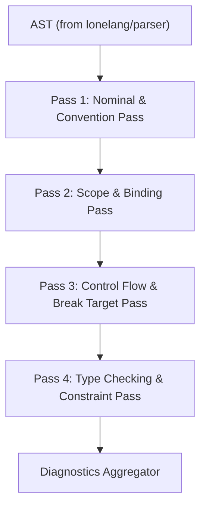

# Research & Architecture Draft: `lone-alyzer`

- **Author**: Antigravity & ctlinker
- **Date**: 2026-11-01
- **Status**: Draft / RFC

---

## 1. Vision & Core Mission

`lone-alyzer` is the static analysis engine, semantic validator, and Language Server Protocol (LSP) foundation for the **Lone Programming Language**.

Its mission is to take the untyped, raw AST produced by `lonelang/parser` and perform multi-pass analysis to:
1. Verify lexical and nominal constraints (naming conventions, casing, keywords).
2. Construct lexical scope hierarchies via a stack-based scope manager.
3. Resolve identifiers and label targets across lexical scopes.
4. Validate control flow legality (`break` within target labels/loops, `return` within function scopes).
5. Infer and check types, enforcing explicit constraints (`ro`, `?`, `comptime`).
6. Emit structured, machine-readable diagnostics (errors, warnings, hints).

---

## 2. Stack-Based Scope Model (`ScopeStack`)

Lone has lexical block scoping with explicit label binding. Analysis of a file maintains an active **Scope Stack**:

```
+--------------------------------------------------+
| Scope 3: Loop / Block (local vars, break target) |  <-- Top of Stack
+--------------------------------------------------+
| Scope 2: Function Scope (params, return type)    |
+--------------------------------------------------+
| Scope 1: File / Module Scope (globals, fns, types)|  <-- Bottom of Stack
+--------------------------------------------------+
```

### 2.1 Scope Kinds
- `ScopeFile`: Root file scope containing top-level declarations.
- `ScopeFunction`: Function body scope tracking parameter bindings, return type expectations, and recursion.
- `ScopeBlock`: Local statement block `{ ... }`.
- `ScopeLabel`: Labeled block or control statement (`blk: { ... }`, `loop: while ...`).
- `ScopeLoop`: Loop boundary (`while ...`) enabling unlabeled `break`.

### 2.2 Scope Operations
- `PushScope(kind, name)`: Creates and pushes a new lexical frame.
- `PopScope()`: Exits the current frame, verifying unclosed references or unused locals.
- `DefineSymbol(sym)`: Registers a variable, function, type, or label in the current frame.
- `ResolveSymbol(name)`: Searches frames from top (innermost) to bottom (root file), returning the nearest binding or an "undefined symbol" diagnostic.
- `ResolveLabel(name)`: Searches the scope stack for an active label frame with `name`.

---

## 3. Multi-Pass Pipeline (N-Pass Architecture)

Rather than monolithic single-pass traversal, `lone-alyzer` runs $N$ distinct passes over the file AST. This cleanly isolates concerns and handles forward references:



### Pass 1: Nominal & Naming Convention Pass
Enforces Lone's invariant **IL1 (Explicit over implicit)** and casing rules:
- **Local Variables & Function Parameters**: Must be `snake_case` (e.g. `user_id`, `buffer_length`).
- **Global / Top-level Constants**: Must be `ALL_CAPS` (e.g. `MAX_COUNT`, `DEFAULT_TIMEOUT`).
- **Functions**: Must be `snake_case` (or `#` prefixed for intrinsics/constructors like `#init`).
- **Types / Structs / Records**: Must be `CamelCase` (e.g. `UserData`, `Color`).
- **Labels**: Must be `snake_case` (e.g. `blk`, `eval_loop`).
- Flags any non-conforming identifier with a `DiagnosticWarning` or `DiagnosticError` containing exact position coordinates.

### Pass 2: Scope & Declaration Collection
- Traverses top-level bindings (`BIND_DEC`, `FN_DEC`, `LABEL_DEC`).
- Populates the root `ScopeFile` symbol table.
- Detects duplicate declarations in the same scope frame.
- Enables forward referencing (functions calling functions declared lower in the file).

### Pass 3: Scope Resolution & Control Flow Validation
- Walks nested statements and expressions using the `ScopeStack`.
- Verifies that every `NameRef` resolves to a declared symbol.
- Verifies `ReturnStmt`: must occur inside a `ScopeFunction` and match the function's return signature.
- Verifies `BreakStmt`:
  - If labeled (`break blk: val`): checks that a matching `ScopeLabel` with name `blk` exists in the current ancestor stack.
  - If unlabeled (`break`): checks that a `ScopeLoop` exists in the ancestor stack.

### Pass 4: Type Inference & Constraint Validation
- Verifies expression types against declared bindings.
- Validates type constraints:
  - Modifying `ro` (read-only) variables or parameters is forbidden.
  - Assigning `none` to non-optional (`?`) types is forbidden.
  - Verifies compile-time evaluation requirements for `comptime`.

---

## 4. Diagnostics Model

All issues are collected into a unified diagnostics list:

```go
type Severity int

const (
    SeverityHint Severity = iota
    SeverityWarning
    SeverityError
)

type Diagnostic struct {
    Message  string
    Severity Severity
    Pos      ir.Position
    Rule     string // e.g. "naming/variable-snake-case"
}
```

---

## 5. First Case Implementation: Naming Conventions

### Convention Rules
1. **`isSnakeCase(s)`**:
   - Starts with lowercase letter `a-z`.
   - Characters are `a-z`, `0-9`, or `_`.
   - No uppercase characters.
2. **`isAllCaps(s)`**:
   - Starts with uppercase letter `A-Z`.
   - Characters are `A-Z`, `0-9`, or `_`.
   - No lowercase characters.
3. **`isCamelCase(s)`**:
   - Starts with uppercase letter `A-Z`.
   - Characters are alphanumeric `a-zA-Z0-9` (no underscores).
4. **`isIntrinsic(s)`**:
   - Starts with `#`, followed by `snake_case` (e.g. `#init`).

### Enforcement Points
- `BIND_DEC` at top level without explicit mutability: checked for `ALL_CAPS` or `snake_case`.
- `BIND_DEC` inside blocks / functions: must be `snake_case`.
- `FN_DEC`: name must be `snake_case` or `isIntrinsic`.
- `FnParam`: parameter names must be `snake_case`.
- `LABEL_DEC`: label name must be `snake_case`.
