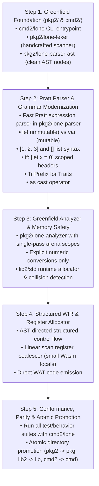

# RFC: Lone Language Refinements & Compiler Architecture Specification

- **Author**: Lone Compiler Engineering Team & AI Pair
- **Date**: 2026-11-03
- **Status**: Proposal / Draft RFC
- **Branch**: `audit/language-inconsistencies-and-improvements`
- **Related Specs**: [`drafts/SPEC.md`](file:///home/char-c/Projects/lone/drafts/SPEC.md), [`drafts/reports/2026-11-03/2026-11-03_language_audit_inconsistencies_and_bottlenecks.md`](file:///home/char-c/Projects/lone/drafts/reports/2026-11-03/2026-11-03_language_audit_inconsistencies_and_bottlenecks.md)

---

## 1. Introduction & Objectives

This Request for Comments (RFC) establishes the concrete design, grammar modifications, semantic rules, and compiler algorithms to resolve the inconsistencies and bottlenecks identified in the November 2026 Lone Language Audit.

### Core Objectives:
1. **Enforce Immutability by Default**: Differentiate `let` (immutable binding) from `var` (mutable binding).
2. **Harmonize Collection Literals & Types**: Adopt `[1, 2, 3]` and `[]` for lists/arrays; reserve `{ ... }` for struct literals and blocks.
3. **Correct AST Comparison Operators**: Rectify inverted operator string constants.
4. **Formalize Control Flow Syntactic Rationale**: Document the design invariants governing conditions across statements.
5. **Eliminate Silent Coercions via Explicit `as` Casts**: Implement the `as` operator and forbid un-emitted implicit conversions.
6. **Demystify Pointers (`ptr<T>`), References (`ref<T>`), and Intrinsics**: Clarify semantics, remove `#refGrab`, and migrate `#ptr_to_str`.
7. **Simplify Trait Naming with `Tr` Prefix**: Replace the `...Trait` suffix with `Tr` + PascalCase (e.g. `TrWriter`, `TrIterator`).
8. **Pratt Expression Parser Architecture**: Outline the transition from 15-tier PEG cascades to $O(N)$ top-down operator precedence.
9. **Demystify Virtual Register Sprawl & Register Allocation**: Explain the WebAssembly local explosion and detail a linear scan solution.
10. **Structured Control Flow Reconstruction in WIR**: Analyze trade-offs (Relooper vs AST-directed vs Region trees).
11. **Production Linear Memory Architecture**: Define safe stack/heap partitioning, collision checks, `memory.grow`, and free lists.
12. **Drafting Key Language Evolution**: Generics/Monomorphization, Algebraic Data Types (`enum`), Exhaustive `match`, and `Result<T, E>`.
13. **Scoped Condition Headers (`if: [bindings] ...`)**: Unify `: [...]` as a core scoped header idiom across both standard and packed `if`.
14. **Greenfield Engine Architecture (`pkg2/`, `lib2/`, `cmd2/`)**: Build the next-generation Pratt-based compiler engine in parallel to eliminate legacy technical debt without workflow disruption.

---

## 2. Language & Syntax Specifications

### 2.1 The `let` vs. `var` Immutability Model

#### 2.1.1 Motivation
In accordance with **IL1 (Explicit over implicit)**, variable mutability must not be ambiguous. Under current Lone, `let` and `var` are identical, leading developers to assume `let` bindings are immutable when they are freely reassignable.

#### 2.1.2 Syntax & Semantics
- **`let name [: Type] = expr`**: Declares an **immutable binding**. Reassigning to `name` triggers a static semantic error.
- **`var name [: Type] [= expr]`**: Declares a **mutable binding**. Can be reassigned via `=` assignment statements.

```lone
let MAX_USERS = 100
var counter = 0

counter = counter + 1   -- Valid: counter is declared with var
MAX_USERS = 200         -- Static Analysis Error: cannot reassign immutable binding 'MAX_USERS'
```

#### 2.1.3 Compiler Implementation
1. **AST Node (`pkg/lone-parser-ast/dec.go`)**:
   Add `IsMutable bool` to `loneast.BIND_DEC`:
   ```go
   type BIND_DEC struct {
       Name      string
       IsPublic  bool
       IsMutable bool // true for 'var', false for 'let'
       Pos       Position
       Value     Expr
       Type      TYPE_REF
   }
   ```
2. **Parser (`pkg/lone-parser/parser.peg`)**:
   ```peg
   BIND_DEC <- 
       pub:(KW_PUB _)?
       kw:(KW_VAR / KW_LET)
       _ 
       name:IDENTIFIER 
       vtype:BIND_TYPE_ANNOT?
       value:(_ "=" _ EXPR)? {
           isMut := string(kw.([]uint8)) == "var"
           return ir.BIND_DEC{
               Pos: currentPosition(c),
               IsPublic: pub != nil,
               IsMutable: isMut,
               Name: string(AnyValToType[[]uint8]("BIND_DEC.name", name)),
               Value: resolved,
               Type: resolved_type,
           }, nil
       }
   ```
3. **Semantic Analyzer (`pkg/lone-analyzer/eval_type.go`)**:
   In `analyzeAssignStmt`:
   ```go
   if sym := te.stack.Lookup(targetName); sym != nil {
       if !sym.IsMutable {
           te.addDiag(SeverityError, a.Pos, "type/immutable-reassignment",
               fmt.Sprintf("cannot reassign immutable binding %q declared with 'let'; use 'var' if mutation is intended", sym.Name))
       }
   }
   ```

---

### 2.2 Collection Literals vs. Types (`[1, 2, 3]` and `{ .x: 1 }`)

#### 2.2.1 Motivation
Currently, list types use square brackets (`[4]i32`, `[]str`), index access uses square brackets (`items[0]`), but list literals use curly braces `{ 1, 2, 3 }`. Furthermore, `{}` is syntactically unparseable because both list and struct literal rules require at least one element.

#### 2.2.2 Syntax Specification
1. **List / Array Literals**: Enclosed in square brackets `[ ... ]`:
   ```lone
   var numbers: []i32 = [1, 2, 3, 4]
   var matrix: [][]i32 = [[1, 0], [0, 1]]
   var empty_list: []str = []
   ```
2. **Struct / Object Literals**: Enclosed in curly braces `{ .field: val, ... }`:
   ```lone
   var pos = { .x: 10, .y: 20 }
   var unit = Point::{ .x: 0, .y: 0 }
   var empty_record = EmptyRecord::{}
   ```
3. **Code Blocks**: Enclosed in curly braces `{ stmt; ... }`.

#### 2.2.3 Grammar Updates (`pkg/lone-parser/parser.peg`)
```peg
LIST_LITERAL <- "[" _ exprs:EXPR_LIST? _ "]" {
    var content []ir.Expr
    if exprs != nil {
        content = AnyValToType[[]ir.Expr]("ListLiteral.exprs", exprs)
    }
    return ir.ListLiteral{
        Content: content,
        Pos: currentPosition(c),
    }, nil
}

OBJECT_LITERAL <- "{" _ f:Field_val_list? _ "}" {
    var fields []ir.FieldAssign
    if f != nil {
        fields = AnyValToType[[]ir.FieldAssign]("ObjectLiteral.fields", f)
    }
    return ir.ObjectLiteral{
        Fields: fields,
        Pos: currentPosition(c),
    }, nil
}
```

---

### 2.3 AST Comparison Operator Constants Fix

In [`pkg/lone-parser-ast/expr.go#L58-L63`](file:///home/char-c/Projects/lone/pkg/lone-parser-ast/expr.go#L58-L63), correct the inverted comparison symbols:

```go
const (
	BINARY_OP_PLUS       BinaryOp = "+"
	BINARY_OP_MINUS      BinaryOp = "-"
	BINARY_OP_TIME       BinaryOp = "*"
	BINARY_OP_DIV        BinaryOp = "/"
	BINARY_OP_MOD        BinaryOp = "%"
	BINARY_OP_AND        BinaryOp = "and"
	BINARY_OP_OR         BinaryOp = "or"
	BINARY_OP_XOR        BinaryOp = "xor"
	BINARY_OP_CARET      BinaryOp = "^"
	BINARY_OP_LESS       BinaryOp = "<"   // Fixed from ">"
	BINARY_OP_LESS_EQ    BinaryOp = "<="  // Fixed from ">="
	BINARY_OP_EQ         BinaryOp = "=="
	BINARY_OP_NOT_EQ     BinaryOp = "!="
	BINARY_OP_GREATER    BinaryOp = ">"   // Fixed from "<"
	BINARY_OP_GREATER_EQ BinaryOp = ">="  // Fixed from "<="
)
```

---

### 2.4 Control Flow Syntactic Rationale & Scoped Condition Headers

#### 2.4.1 Control Flow Syntactic Framing
Lone intentionally utilizes distinct syntactic framing across control flow constructs to prevent ambiguity without relying on mandatory statement semicolons:

| Construct | Syntax | Design Invariant & Rationale |
| :--- | :--- | :--- |
| **Standard `if`** | `if cond { ... }` | **Minimalism & Left-to-Right Flow**: No redundant parentheses around `cond`. The opening `{` unambiguously terminates the condition. |
| **Standard `while`** | `while cond { ... }` | **Consistency**: Mirrors standard `if`. Condition ends at `{`. |
| **Post-Condition Loop** | `loop { ... } while: [cond]` | **Trailing Line-Bleed Prevention**: In C/Java, `do { ... } while (x > 0);` requires a trailing semicolon; omitting it causes the parser to treat the next line as part of an expression. By requiring `while:` with bracketed `[cond]`, Lone provides a rigid closing boundary without semicolons. |
| **Iteration Loop** | `for item in iter { ... }` | **Explicit Iteration**: Keyword `in` unambiguously binds the variable to an iterator protocol without parentheses. |
| **Packed `if`** | `if { c1 => e1, else => e2 }` | **Concise Branching**: Fat arrow `=>` separates condition from body arm within an expression block. |

---

#### 2.4.2 Scoped Condition Headers: `if: [bindings] ...`

##### Motivation & Pattern Generalization
In Lone, the `: [...]` punctuation was initially introduced for post-condition loops (`loop { ... } while: [cond]`). We now generalize `: [...]` into a **unified header clause** across Lone's control flow statements. 

Specifically, developers frequently need to compute or extract values immediately before testing them, without leaking those variables into the outer lexical scope. Lone introduces **Scoped Condition Headers** for both standard `if` and packed `if`:

```lone
-- 1. Standard if with a scoped binding header
if: [let x = 0] x != 9 {
    break 
}

-- 2. Packed if with multiple scoped bindings in the header
if: [let x = 0, let y = 7] {
    x is int and y is int => {
        print("Both are integers")
    },
    else => {
        print("Fallback")
    }
}
```

##### Syntactic Specification
1. **Header Clause**: An optional `: [` followed by a comma-separated list of `let` or `var` bindings, terminated by `]`.
2. **Standard `if` Form**:
   ```lone
   if: [binding_list] condition {
       -- then branch
   } else if: [binding_list] condition {
       -- else-if branch
   } else {
       -- else branch
   }
   ```
3. **Packed `if` Form**:
   ```lone
   if: [binding_list] {
       cond1 => expr1,
       cond2 => expr2,
       else => expr3,
   }
   ```

##### Scoping & Lifetime Semantics
- **Strict Scope Isolation**: Bindings defined in `if: [let a = expr]` exist strictly within the evaluated conditional construct:
  - Accessible in the condition expression `cond`.
  - Accessible within the then-block `{ ... }`.
  - Accessible within subsequent `else if` and `else` branches of the same chain.
  - Drop out of scope immediately when the entire `if` statement finishes.
- **Mutability in Headers**: Both immutable bindings (`let`) and mutable bindings (`var`) are supported:
  - `if: [let res = compute()] res > 0 { ... }` (res is immutable).
  - `if: [var cursor = stream.read()] cursor.has_more() { cursor.advance() }` (cursor can be mutated).
- **Multiple Bindings**: Comma-separated: `if: [let a = 1, var b = 2] ...`.

##### AST Representation
In [`pkg/lone-parser-ast/expr.go`](file:///home/char-c/Projects/lone/pkg/lone-parser-ast/expr.go):
```go
type IfStmt struct {
    Header []BIND_DEC // Scoped header bindings (empty if no ': [...]')
    Cond   Expr
    Then   Block
    Else   any        // nil, Block, or IfStmt
    Pos    Position
}
```

##### Desugaring & Lowering
During semantic analysis, an `if: [bindings] cond { body } else { el }` statement desugars cleanly into a scoped synthetic block containing the bindings followed by the branching statement:
```lone
{
    let x = 0
    if x != 9 {
        break
    }
}
```
This guarantees zero runtime overhead and preserves optimal WebAssembly structured control flow emission.

---

### 2.5 Explicit Numeric Casts (`as` Operator)

#### 2.5.1 Motivation
WebAssembly is strictly typed at the value level (`i32`, `i64`, `f32`, `f64`). Implicit conversions between integers and floats or between 64-bit and 32-bit types invite precision loss, hide allocations, and lead to Wasm validation failures if the compiler omits conversion instructions.

#### 2.5.2 Language Rule
1. **No Implicit Numeric Widening or Narrowing**: Passing `i32` to an `f32` parameter or assigning `f64` to `f32` is a compile-time type mismatch error.
2. **Explicit `as` Cast Operator**: Type conversion must be expressed explicitly:
   ```lone
   var int_val: i32 = 42
   var float_val: f32 = int_val as f32
   var wide_int: i64 = int_val as i64
   var byte_val: u8 = int_val as u8
   ```

#### 2.5.3 WebAssembly Instruction Lowering
The MIR compiler translates `as` into dedicated conversion opcodes:

| Cast Expression | Wasm Instruction | Semantics |
| :--- | :--- | :--- |
| `i32 as i64` | `i64.extend_i32_s` (or `_u`) | Sign/Zero extend 32-bit int to 64-bit |
| `i64 as i32` | `i32.wrap_i64` | Truncate high 32 bits |
| `i32 as f32` | `f32.convert_i32_s` (or `_u`) | Signed/Unsigned int to single-precision float |
| `i32 as f64` | `f64.convert_i32_s` (or `_u`) | Signed/Unsigned int to double-precision float |
| `f64 as f32` | `f32.demote_f64` | IEEE 754 float rounding to 32 bits |
| `f32 as f64` | `f64.promote_f32` | Lossless float extension |
| `f32 as i32` | `i32.trunc_f32_s` | Truncate towards zero |

---

### 2.6 Clarifying Pointers (`ptr<T>`), References (`ref<T>`), and Intrinsics

#### 2.6.1 The Relationship Between `ptr<T>` and `ref<T>`
Lone separates memory references into two distinct tiers:

```
                  ┌──────────────────────────────────────────────┐
                  │                 Memory Model                 │
                  └──────────────────────┬───────────────────────┘
                                         │
                 ┌───────────────────────┴───────────────────────┐
                 ▼                                               ▼
         Safe References:                                Raw Addresses:
             ref<T>                                         ptr<T>
  • Created via &x                               • Created via &raw x
  • Guaranteed non-null                          • May be arbitrary offset
  • No pointer arithmetic                        • Allows pointer arithmetic
  • Scope & lifetime checked                     • Unchecked systems access
  • Dereferenced via *r                          • Dereferenced via *p
```

1. **Both Use `*` for Dereference**:
   - `*r` reads or writes the value of a managed reference.
   - `*p` reads or writes the memory at a raw linear memory byte offset.
   - Having both use `*` is consistent with systems programming idioms (C, Rust, Zig).
2. **Deprecation of `#refGrab`**:
   - `#refGrab` was a temporary bootstrapping intrinsic used before unary `*` was implemented in the compiler.
   - **Resolution**: Deprecate and remove `#refGrab`. Developers must use standard `*r`.
3. **Migration of `#ptr_to_str` and `#str_to_ptr`**:
   - Currently, string conversions rely on magic compiler intrinsics (`#ptr_to_str(ptr, len)`).
   - **Resolution**: Move to standard library methods in `:std:sys` and `:std:str`:
     ```lone
     -- In :std:str
     pub fn from_raw_parts(address: ptr<u8>, length: i32) str
     pub fn as_ptr(self: str) ptr<u8>
     ```

---

### 2.7 Trait Naming Convention: The `Tr` Prefix

#### 2.7.1 Motivation
Requiring trait names to end with `Trait` created lexical collisions with valid English words (`portrait`, `strait`), requiring hardcoded exception lists in `lone-analyzer`.

#### 2.7.2 The `Tr` + PascalCase Rule
Traits **must** begin with the two-character prefix `Tr` followed immediately by an uppercase letter (`PascalCase`):
- `TrWriter`
- `TrReader`
- `TrIterator`
- `TrIterable`
- `TrComparable`
- `TrDisplay`
- `TrClone`

Non-trait structs, types, and functions must **not** begin with `Tr` followed by an uppercase letter.

#### 2.7.3 Advantages:
1. **Left-to-Right Signifier (Invariant IF2)**: The trait nature is declared at the first character, not hidden at the tail of a long identifier.
2. **Zero English Collisions**: Standard English words do not contain uppercase `Tr` followed by uppercase letters.
3. **Concise**: Replaces 5 characters (`Trait`) with 2 (`Tr`).

---

## 3. Compiler & Backend Subsystem Architecture

### 3.1 Pratt Expression Parser Architecture

#### 3.1.1 Problem Statement
The generated Pigeon PEG parser currently cascades through 15 separate expression non-terminals:
`EXPR -> LOGICAL_OR -> LOGICAL_XOR -> LOGICAL_AND -> BITWISE_OR -> BITWISE_XOR -> BITWISE_AND -> EQUALITY -> IS -> COMPARISION -> ADD -> MUL -> UNARY -> POSTFIX -> PRIMARY`.
Every identifier or number inside an expression triggers 15 function calls and slice allocations.

#### 3.1.2 Pratt Parser Design
A Pratt Parser (Top-Down Operator Precedence) parses expressions iteratively in a single loop using binding powers:

```go
type Precedence int

const (
    PrecNone Precedence = iota
    PrecAssignment       // =
    PrecLogicalOr        // or, ||
    PrecLogicalXor       // xor
    PrecLogicalAnd       // and, &&
    PrecBitwiseOr        // |
    PrecBitwiseXor       // ^
    PrecBitwiseAnd       // &
    PrecEquality         // ==, !=
    PrecComparison       // <, <=, >, >=, is
    PrecCast             // as
    PrecTerm             // +, -
    PrecFactor           // *, /, %
    PrecUnary            // !, -, +, *, &raw, &
    PrecPostfix          // ., (), [], ::
)

func (p *Parser) ParseExpr(minPrec Precedence) Expr {
    token := p.advance()
    left := p.parsePrefix(token)

    for minPrec <= p.currentPrecedence() {
        opToken := p.advance()
        left = p.parseInfix(left, opToken)
    }

    return left
}
```
**Benefits**:
- Parsing speed improves by $5\times$ to $10\times$ on complex expressions.
- Memory allocations drop from $O(N \cdot D)$ to $O(N)$ AST nodes.

---

### 3.2 Virtual Register Explosion & Linear Scan Register Allocator

#### 3.2.1 The Issue Explained
In `pkg/lone-compiler-mir/lower.go`, every subexpression, memory slot calculation, and temporary comparison calls:
```go
reg := l.freshReg("t_bin", mType)
```
Each unique name (`t_bin1`, `t_bin2`, ..., `t_bin120`) is added to `fn.Locals`.
In `pkg/lone-compiler-wir/lower.go`, every entry in `fn.Locals` is declared as a WebAssembly local:
```wat
(func $calculate (result i32)
  (local $t_bin1 i32)
  (local $t_bin2 i32)
  ...
  (local $t_bin95 i32)
```
**Consequences**:
1. **Wasm Bytecode Bloat**: Excessive local declarations swell file size.
2. **JIT Compilation Overhead**: WebAssembly runtimes (V8, Wasmtime) allocate stack slots and maintain liveness tracking for all declared locals during JIT compilation.
3. **Execution Slowdown**: Heavy register pressure leads to cache thrashing and memory spilling.

#### 3.2.2 The Solution: Linear Scan Register Allocator
Instead of emitting one local per virtual register, the compiler calculates **live intervals** `[start_pc, end_pc]` for each register:

```
Register   Live Range      Assigned Wasm Local
─────────────────────────────────────────────────
t_bin1     [10, 15]   ───►  $i32_0
t_bin2     [12, 18]   ───►  $i32_1
t_bin3     [19, 24]   ───►  $i32_0  (Reused! t_bin1 is dead)
t_bin4     [20, 28]   ───►  $i32_1  (Reused! t_bin2 is dead)
```

**Algorithm Steps**:
1. **Liveness Analysis**: Walk instructions backward to find the definition point and last use of each virtual register.
2. **Interval Sorting**: Sort intervals by start instruction index.
3. **Allocation Loop**: Maintain active intervals; when an interval expires, return its Wasm local to the free pool.
4. **Local Coalescing**: Map virtual registers directly to pooled locals (`$i32_0`, `$i32_1`, `$f64_0`).

**Impact**: Functions that previously emitted 80+ locals will emit **4 to 8 locals**, reducing WAT output size by ~30% and speeding up Wasm engine compilation.

---

### 3.3 Structured Control Flow Reconstruction in WIR: Trade-off Analysis

WebAssembly 1.0 requires structured control flow (`block`, `loop`, `if ... else ... end`, `br`, `br_if`). It forbids arbitrary jumps between basic blocks.

#### Comparison of Approaches:

| Approach | How It Works | Pros | Cons | Recommendation |
| :--- | :--- | :--- | :--- | :---: |
| **Option A: Full Relooper / Stackifier** (LLVM / Emscripten style) | Runs graph algorithms (dominator trees, loop analysis) on flat MIR basic blocks to synthesize nested Wasm blocks. | • Can compile arbitrary, tangled CFGs.<br/>• Decouples MIR optimizations from backend. | • High complexity (~1,200 lines of Go).<br/>• Introduces synthetic dispatch variables (`__state`) on irreducible graphs. | Deferred to v3 |
| **Option B: AST-Directed Structured Lowering** | Retains high-level structured nodes (`If`, `While`, `Loop`, `PackedIf`) directly into WIR, bypassing flat basic-block jumps for structured constructs. | • **Simple & Robust** (~300 lines).<br/>• Emits 100% natural Wasm `block`/`loop`/`if` nesting.<br/>• Zero synthetic dispatch loops. | • MIR is less "pure" as a flat CFG for classical compiler optimizations. | **Recommended for Lone** |
| **Option C: Enhanced Heuristic Region Matcher** (Current approach) | Matches block name prefixes (`while_head_`, `dowhile_`, `join_`). | • Minimal code changes to existing codebase. | • Fragile. Breaks on complex break/continue combinations or multi-level labeled loops. | Reject |

**Decision**: Adopt **Option B (AST-Directed Structured Lowering)**. Because Lone's front-end already guarantees structured control flow without `goto`, preserving structured blocks through MIR directly to WIR guarantees valid WebAssembly without the heavy overhead of a full Relooper.

---

### 3.4 Production Linear Memory Architecture

#### 3.4.1 Current Unsafe Layout vs. Proposed Safe Layout

```
CURRENT (Unsafe & Static):
[0..15]         WASI #print scratch buffer (hardcoded overwrite!)
[16..dataEnd]   Static string literals
[dataEnd..SP)   Heap arena (bump-allocated upward via $__heap_pointer)
(SP..131072]    Datastack (bump-allocated downward via $__stack_pointer)
*** NO COLLISION CHECKS: Heap smashes Stack upon exceeding 128 KiB ***

PROPOSED (Safe, Partitioned & Dynamic):
[0..63]         Reserved Runtime Header (panic info, WASI iovec)
[64..dataEnd]   Static String Table & Global Constants (4-byte aligned)
[dataEnd..heap] Dynamic Heap Arena (managed via TLSF / Free-List)
                ════════════════════════════════════════════════
                GUARD PAGE (Soft trap / Collision boundary)
                ════════════════════════════════════════════════
[stack..Top]    Datastack / Shadow Stack (grows downwards from StackTop)
```

#### 3.4.2 Key Invariants & Safeguards:
1. **Dynamic Page Growth (`memory.grow`)**:
   When the heap approaches the guard boundary, invoke `memory.grow` to append 64 KiB pages, expanding linear memory dynamically up to the host limit.
2. **Stack-Heap Collision Detection**:
   In function prologues allocating datastack frames (`fn.FrameSize > 0`):
   ```wat
   global.get $__stack_pointer
   i32.const <FrameSize>
   i32.sub
   global.get $__heap_pointer
   i32.le_u
   if
     call $__lone_rt_panic_stack_overflow
     unreachable
   end
   ```
3. **Free-List Heap Allocator in `:std:sys`**:
   Replace the monotonic bump pointer with an in-tree two-level segregated fit (TLSF) or boundary-tag free-list allocator implementing `alloc(size: i32) ptr<u8>` and `free(p: ptr<u8>, size: i32) void`.

---

### 3.5 Greenfield Engine Architecture: `pkg2/`, `lib2/`, `cmd2/`

#### 3.5.1 The Strategic Rationale for a Parallel Greenfield
Replacing Pigeon PEG with a hand-crafted Pratt parser, transitioning WIR to AST-directed structured lowering, and revamping register allocation represents a foundational rewrite of the compiler frontend and backend. Attempting in-place edits within `pkg/` risks regressions across existing tests and toolchains.

Adopting a parallel **`pkg2/`**, **`lib2/`**, and **`cmd2/`** tree provides:
1. **Zero Regressions**: The active compiler (`pkg/`, `cmd/lone`) remains 100% stable, green, and operational throughout development.
2. **Clean-Room Design**: No residual baggage from Pigeon PEG generated code (`generated-parser.go`), ad-hoc block name heuristics, or unmonomorphized MIR templates.
3. **Instant Verification**: Both compilers can be run concurrently on identical `.lone` test programs:
   ```bash
   go run ./cmd/lone build test.lone   # Legacy v1 compiler
   go run ./cmd2/lone build test.lone  # Greenfield v2 compiler
   ```
4. **Atomic Cutover**: Once `cmd2/lone` passes all conformance suites, promotion to primary (`pkg2` $\rightarrow$ `pkg`, `lib2` $\rightarrow$ `lib`, `cmd2` $\rightarrow$ `cmd`) is an instantaneous directory swap.

#### 3.5.2 Greenfield Directory Layout

```
cmd2/
  └── lone/                    # Unified Next-Gen CLI (lone build, check, run, lsp)
pkg2/
  ├── lone-lexer/              # Hand-crafted, zero-allocation token scanner
  ├── lone-parser-ast/         # Clean AST (IsMutable, [lists], if:[headers], Tr traits, as casts)
  ├── lone-parser/             # Pratt expression parser + Recursive Descent statements
  ├── lone-analyzer/           # Unified semantic analyzer (single-pass, arena scope stack)
  ├── lone-compiler-mir/       # Mid-level IR with Monomorphization engine
  ├── lone-compiler-wir/       # AST-directed structured Wasm IR + Linear scan allocator
  ├── lone-shared-logger/      # Diagnostic span emitter with inline carets and notes
  └── lone-lsp/                # Next-generation LSP server
lib2/
  ├── std/                     # Target standard library written in Lone (:std:io, :std:str, :std:sys)
  └── runtime/                 # Minimal WASI Preview 1 stubs & Node/Browser adapters
```

#### 3.5.3 Greenfield Subsystem Blueprints

1. **`pkg2/lone-lexer`**:
   - Single-pass scanning over UTF-8 bytes into a flat slice of `Token` structs.
   - Eliminates regex and Pigeon lookahead backtracking entirely.
   - Tracks line, column, byte offsets, and trivia (comments/whitespace) cleanly for the LSP.

2. **`pkg2/lone-parser`**:
   - **Declarations & Statements**: Clean, readable recursive descent functions (`parseFnDec()`, `parseIfStmt()`, `parseLoopStmt()`).
   - **Expressions**: $O(N)$ Pratt Parser using a static precedence binding power table (`parseExpr(minPrec)`).
   - Zero Pigeon dependency, zero 9,500-line generated files, blazing-fast Go compile times.

3. **`pkg2/lone-analyzer`**:
   - Enforces `let` immutability by default.
   - Validates `if: [bindings]` scoping rules.
   - Enforces `Tr` + PascalCase trait definitions.
   - Forbids implicit cross-type numeric coercions; requires explicit `as` casts.
   - Arena-backed symbol tables eliminating map allocations on block entry/exit.

4. **`pkg2/lone-compiler-wir`**:
   - AST-directed structured control flow: translates high-level loops and branches directly into nested Wasm `block`, `loop`, and `if` AST nodes without string-based block name matching.
   - Linear scan register allocator: maps virtual registers to a compact pool of typed locals (`$i32_0`, `$i32_1`).
   - Emits collision detection checks between stack pointer and heap pointer.

---

## 4. Pillar IV: Key Language Gaps & Proposals

### 4.1 Generics & Monomorphization Engine

#### 4.1.1 Overview
Lone allows declaring generic structs and traits:
```lone
pub type Range<T> = struct {
    current: T,
    end: T,
    step: T,
}
```
Currently, the analyzer parses `<T>`, but the MIR backend cannot specialize structs or functions.

#### 4.1.2 Monomorphization Pipeline
During MIR lowering, every concrete instantiation (`Range<i32>`, `Range<f64>`) is stamped out as a distinct, specialized type:
1. **Mangled Naming**: `Range$i32`, `Range$f64`.
2. **Layout Calculation**:
   - `Range$i32`: 3 fields $\times$ 4 bytes = 12 bytes.
   - `Range$f64`: 3 fields $\times$ 8 bytes = 24 bytes.
3. **Specialized Methods**: `Range$i32_next(self: ptr<Range$i32>) i32`.

---

### 4.2 Tagged Unions (`enum`) & Pattern Matching (`match`)

#### 4.2.1 Syntax
```lone
pub type Shape = enum {
    Circle(radius: f32),
    Rect(width: f32, height: f32),
    Point,
}

fn area(s: Shape) f32 {
    return match s {
        Circle(r) => 3.14159 * r * r,
        Rect(w, h) => w * h,
        Point => 0.0,
    }
}
```

#### 4.2.2 Memory Representation
Tagged unions are represented in linear memory as:
`[discriminant: i32] [payload: union of all variants]`
- `Circle`: tag = `0`, payload = 4 bytes (`f32`)
- `Rect`: tag = `1`, payload = 8 bytes (`f32, f32`)
- Total size: 4 bytes (tag) + 8 bytes (payload) = 12 bytes.

#### 4.2.3 Semantic Checks
- **Exhaustiveness**: `match` expressions must cover all enum variants or provide a default `_ => expr` arm.

---

### 4.3 Ergonomic Error Handling (`Result<T, E>` and `?` Operator)

#### 4.3.1 Standard Result Enum
Defined in `:std:sys`:
```lone
pub type Result<T, E> = enum {
    Ok(value: T),
    Err(error: E),
}
```

#### 4.3.2 The `?` Error Propagation Operator
A postfix `?` unwraps `Ok(value)` or returns early from the current function with `Err(error)`:
```lone
fn read_config() Result<Config, str> {
    var raw_bytes = read_file("config.json")?
    var parsed = parse_json(raw_bytes)?
    return Result::Ok(parsed)
}
```
Desugars cleanly into:
```lone
var __tmp = read_file("config.json")
match __tmp {
    Ok(v) => v,
    Err(e) => return Result::Err(e),
}
```

---

### 4.4 Standard Library Reorganization (`libraries/` -> `lib/`)

Align the repository structure with **Architecture v2** (`AGENT.md`):
- Move `libraries/std/` $\rightarrow$ `lib/std/`.
- Move `libraries/c-wasi-runtime/` $\rightarrow$ `lib/runtime/c-wasi/`.
- Introduce new standard modules:
  - `lib/std/str.lone`: String views, slicing, search, trim, formatting.
  - `lib/std/vec.lone`: Dynamic growable array `Vec<T>`.
  - `lib/std/map.lone`: Linear probing hash map `Map<K, V>`.

---

## 5. Implementation Roadmap & Phasing (Greenfield Strategy)



- **Step 1: Greenfield Foundation (`pkg2/`, `cmd2/`, `lib2/`)**:
  - Establish `cmd2/lone` driver and `pkg2/lone-lexer`.
  - Establish `pkg2/lone-parser-ast` with clean immutable `let`, bracketed lists, scoped headers (`if: [bindings]`), and `Tr` trait names.
- **Step 2: Hand-Crafted Pratt Parser**:
  - Implement recursive descent statement parsing + $O(N)$ Pratt expression parsing in `pkg2/lone-parser`.
  - Zero Pigeon PEG dependency, zero 9,500-line generated files.
- **Step 3: Greenfield Semantic Analyzer & Safe Memory**:
  - Implement `pkg2/lone-analyzer` enforcing `let` immutability, `if: [bindings]` scoping, `as` casts, and `Tr` traits.
  - Implement safe memory layout with datastack/heap collision detection in `lib2/std`.
- **Step 4: Greenfield Backend (MIR & Structured WIR)**:
  - Implement AST-directed structured lowering in `pkg2/lone-compiler-wir`.
  - Implement linear scan register allocator to eliminate Wasm local explosion.
- **Step 5: Parity Verification & Atomic Cutover**:
  - Run all behavior and test suites against `cmd2/lone`.
  - Promote `pkg2/` $\rightarrow$ `pkg/`, `lib2/` $\rightarrow$ `lib/`, `cmd2/` $\rightarrow$ `cmd/`.

---

## 6. Conclusion & Recommendation

This RFC provides a concrete, cohesive blueprint for stabilizing Lone's grammar, bolstering its memory model, eliminating compiler performance bottlenecks, and expanding its expressiveness. All proposed changes strictly uphold Lone's foundational invariants (**IL1: Explicit over implicit**, **IF1: Syntax-level feedback**, and **IF2: Progressive information**).
