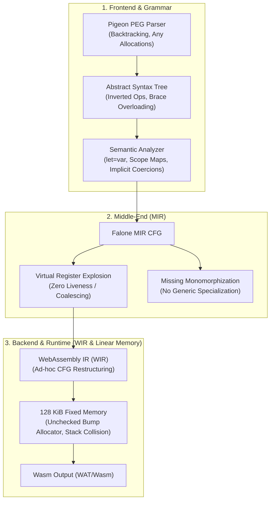

# Architectural Audit: Language Inconsistencies, Subsystem Bottlenecks & Future Possibilities

**Date**: 2026-11-03  
**Branch**: `audit/language-inconsistencies-and-improvements`  
**Target Systems**: `pkg/lone-parser`, `pkg/lone-parser-ast`, `pkg/lone-analyzer`, `pkg/lone-compiler-mir`, `pkg/lone-compiler-wir`, `pkg/lone-runtime`, `libraries/std`  
**Authors**: Lone Compiler Engineering Team & AI Pair

---

## 1. Executive Summary

This audit provides a comprehensive, ground-truth architectural evaluation of the **Lone Programming Language** and its active compiler engine (`Architecture v2`). As Lone matures into a production-grade WebAssembly systems and UI language, this report identifies:
1. **Critical Language & Syntax Inconsistencies** that violate Lone's founding invariants (**IL1: Explicit over implicit**, **IF1: Syntax-level feedback**).
2. **Compiler & Runtime Bottlenecks** spanning parser backtracking, unoptimized intermediate representations, virtual register sprawl, structured control flow reconstruction, and linear memory constraints.
3. **Language Gaps & High-Impact Possibilities** including monomorphized generics, algebraic data types, pattern matching, robust error models, and next-generation memory allocators.
4. **A Phased, Actionable Roadmap** prioritizing fixes to guide subsequent development cycles.



---

## 2. Pillar I: Language & Syntax Inconsistencies

### 2.1 The `let` vs. `var` Immutability Illusion (Severity: Critical)

- **Source Evidence**:
  - [`pkg/lone-parser/parser.peg#L949-L955`](file:///home/char-c/Projects/lone/pkg/lone-parser/parser.peg#L949-L955):
    ```peg
    BIND_DEC <- pub:(KW_PUB _)? (KW_VAR / KW_LET) _ name:IDENTIFIER ...
    ```
  - [`pkg/lone-parser-ast/dec.go#L50-L56`](file:///home/char-c/Projects/lone/pkg/lone-parser-ast/dec.go#L50-L56):
    ```go
    type BIND_DEC struct {
        Name     string
        IsPublic bool
        Pos      Position
        Value    Expr
        Type     TYPE_REF
    }
    ```
  - [`pkg/lone-analyzer/eval_type.go#L1040-L1065`](file:///home/char-c/Projects/lone/pkg/lone-analyzer/eval_type.go#L1040-L1065) (`analyzeAssignStmt`).
- **The Problem**:
  `ir.BIND_DEC` does not retain whether a binding was declared with `let` or `var`. In `lone-analyzer`, all variables are hoisted and treated identically as mutable storage locations. Assigning a new value to a `let` variable (e.g. `let count = 10; count = 20`) generates zero errors and compiles without friction.
- **Invariant Violation**:
  Directly violates **IL1 (Explicit over implicit)**. In modern programming languages (Rust, JavaScript/TypeScript, Swift, Gleam), `let` universally conveys immutability or single assignment. In Lone, `let` is a misleading syntactic alias of `var`.
- **Proposed Solution**:
  1. Add `IsMutable bool` (or `IsLet bool`) to `loneast.BIND_DEC`.
  2. In `loneanalyzer.Symbol`, record `IsMutable bool`.
  3. In `analyzeAssignStmt`, check `sym.IsMutable` and emit a compile-time error (`type/immutable-mutation`: `"cannot reassign immutable binding declared with 'let'; declare with 'var' instead"`).

---

### 2.2 Collection Literals vs. Types: The Brace Overload Clash (Severity: High)

- **Source Evidence**:
  - Array/Slice Types: [`pkg/lone-parser/parser.peg#L808-L830`](file:///home/char-c/Projects/lone/pkg/lone-parser/parser.peg#L808-L830) uses `[N]T` and `[]T`.
  - List Literals: [`pkg/lone-parser/parser.peg#L540-L547`](file:///home/char-c/Projects/lone/pkg/lone-parser/parser.peg#L540-L547) uses `{ expr, ... }`.
  - Object Literals: [`pkg/lone-parser/parser.peg#L513-L520`](file:///home/char-c/Projects/lone/pkg/lone-parser/parser.peg#L513-L520) uses `{ .x: 1, ... }`.
  - Code Blocks: [`pkg/lone-parser/parser.peg#L1166`](file:///home/char-c/Projects/lone/pkg/lone-parser/parser.peg#L1166) uses `{ stmt; ... }`.
- **The Problem**:
  1. **Asymmetric Punctuation**: List types are written with square brackets (`[4]i32` or `[]str`), list indexing uses brackets (`items[0]`), but list literals use curly braces `{ 1, 2, 3 }`.
  2. **The Empty Literal Impossibility**: `{}` cannot be parsed as either an empty list or an empty object. `Field_val_list` requires at least one `.key: val` pair, and `EXPR_LIST` requires at least one expression. Writing `{}` triggers a syntax error or is treated as an empty block statement.
  3. **Grammar Ambiguity**: When an expression statement begins with `{`, the parser struggles to distinguish an inline block, an object literal, or a list literal without lookahead.
- **Proposed Solution**:
  - Adopt square brackets for list literals: `[1, 2, 3]`.
  - Support empty lists natively: `[]` (type inferred or explicit `[]i32::[]`).
  - Reserve `{ ... }` strictly for code blocks and struct/object literals (`{ .x: 10 }`).
  - Support empty structs explicitly: `{}` or `T::{}`.

---

### 2.3 AST Comparison Operator Inversion Landmine (Severity: Medium)

- **Source Evidence**:
  [`pkg/lone-parser-ast/expr.go#L58-L63`](file:///home/char-c/Projects/lone/pkg/lone-parser-ast/expr.go#L58-L63):
  ```go
  BINARY_OP_LESS       BinaryOp = ">"   // INVERTED
  BINARY_OP_LESS_EQ    BinaryOp = ">="  // INVERTED
  BINARY_OP_EQ         BinaryOp = "=="
  BINARY_OP_NOT_EQ     BinaryOp = "!="
  BINARY_OP_GREATER    BinaryOp = "<"   // INVERTED
  BINARY_OP_GREATER_EQ BinaryOp = "<="  // INVERTED
  ```
- **The Problem**:
  The AST string constants have their symbols swapped (`BINARY_OP_LESS` is assigned `">"`, and `BINARY_OP_GREATER` is assigned `"<"`). The parser currently skirts this bug by calling `FoldBinaryExpr` with raw matched text (`c.text`) rather than referencing these constants. However, any external linter, AST optimizer, or diagnostic tool matching on `ir.BINARY_OP_LESS` will misinterpret comparison semantics.
- **Proposed Solution**:
  Correct the constant values immediately to match mathematical reality:
  ```go
  BINARY_OP_LESS       BinaryOp = "<"
  BINARY_OP_LESS_EQ    BinaryOp = "<="
  BINARY_OP_GREATER    BinaryOp = ">"
  BINARY_OP_GREATER_EQ BinaryOp = ">="
  ```

---

### 2.4 Control Flow Condition Heterogeneity (Severity: Low)

- **Source Evidence**:
  - `if cond { ... }` — unbracketed condition.
  - `while cond { ... }` — unbracketed condition.
  - `loop { ... } while: [cond]` — bracketed condition with colon prefix.
  - `for var in iter { ... }` — keyword delimited (`in`).
  - `if { cond => expr, else => expr }` — packed arms with fat arrow `=>`.
- **The Problem**:
  Lone now features four distinct syntactic styles for evaluating conditions. While `loop {} while: [cond]` was specifically designed to eliminate the notorious "semicolon-or-line-bleed" trap of do-while loops without mandatory semicolons, its syntax diverges from every other conditional construct in the language.
- **Proposed Solution**:
  Document `while: [cond]` clearly as an intentional guard against trailing line-bleed ambiguity, or consider whether uniform bracketed conditions (e.g. optional `[cond]` across `if` and `while`) provide future syntactic harmony.

---

### 2.5 Silent Numeric Coercions Without Backend Codegen (Severity: Critical)

- **Source Evidence**:
  - [`pkg/lone-analyzer/types.go#L123-L129`](file:///home/char-c/Projects/lone/pkg/lone-analyzer/types.go#L123-L129):
    ```go
    // Allow numeric flexibility between float types and integer to float
    if (p.Name == "f32" && op.Name == "f64") || (p.Name == "f64" && op.Name == "f32") {
        return true
    }
    if isAnyInt(p.Name) && (op.Name == "f32" || op.Name == "f64") {
        return true
    }
    ```
  - [`pkg/lone-compiler-mir/lower.go`](file:///home/char-c/Projects/lone/pkg/lone-compiler-mir/lower.go) and [`pkg/lone-compiler-wir/lower.go`](file:///home/char-c/Projects/lone/pkg/lone-compiler-wir/lower.go).
- **The Problem**:
  `lone-analyzer` permits `f64` to be assigned to `f32`, and integer types (`i32`, `i64`) to be assigned to float types. However, the MIR and WIR compilers generate **zero** conversion instructions (`f32.demote_f64`, `f32.convert_i32_s`, `f64.convert_i64_s`). When WebAssembly code executes or validates, passing an `i32` local where an `f32` parameter is expected causes an immediate Wasm engine validation fault (`type mismatch`).
- **Proposed Solution**:
  1. Enforce strict type invariance: Disallow implicit cross-category coercions in `AssignableTo`. Require explicit cast expressions or constructor conversions (e.g. `f32::from(x)` or `x as f32`).
  2. If implicit widening is desired (e.g. `i32` -> `i64`, `f32` -> `f64`), the MIR lowerer must emit explicit conversion instructions (`MirConvOp` -> `f64.promote_f32`, `i64.extend_i32_s`).

---

### 2.6 Pointers (`ptr<T>`), References (`ref<T>`) and Missing Lifetime Safety (Severity: High)

- **Source Evidence**:
  - [`drafts/SPEC.md#L141-L157`](file:///home/char-c/Projects/lone/drafts/SPEC.md#L141-L157)
  - [`pkg/lone-analyzer/eval_type.go#L1365-L1395`](file:///home/char-c/Projects/lone/pkg/lone-analyzer/eval_type.go#L1365-L1395)
  - [`pkg/lone-runtime/intrinsic.go`](file:///home/char-c/Projects/lone/pkg/lone-runtime/intrinsic.go) (`#refGrab`, `#ptr_to_str`)
- **The Problem**:
  - `ref<T>` (managed reference created via `&x`) and `ptr<T>` (raw pointer created via `&raw x`) compile to the same underlying WebAssembly type (`i32` byte offset).
  - Both share the unary dereference operator `*x`.
  - While `ro` protects against mutating through a read-only pointer/reference, there is no escape analysis or lifetime tracking. Storing `&local_var` into a global or returning it from a function yields a dangling pointer into an expired datastack frame with zero static warnings.
- **Proposed Solution**:
  - Implement a basic region/lifetime escape pass in `lone-analyzer`: Flag returning `&local` or assigning stack references to longer-lived scopes.
  - Formalize `#refGrab` and `#ptr_to_str` into standard library functions in `:std:sys` rather than compiler intrinsics.

---

### 2.7 Trait Lexical Regex Enforcement vs. Grammatical Types (Severity: Low)

- **Source Evidence**:
  - [`pkg/lone-analyzer/conventions.go#L44-L63`](file:///home/char-c/Projects/lone/pkg/lone-analyzer/conventions.go#L44-L63):
    ```go
    var legitimateTraitSuffixWords = map[string]bool{
        "portrait": true, "strait": true, "distrait": true,
    }
    ```
- **The Problem**:
  The requirement that trait names end in `Trait` (and non-traits do not) is policed through lexical naming conventions in `conventions.go` and `pass_conventions.go` with hardcoded English dictionary exceptions. This blurs the line between grammatical syntax and stylistic linting.
- **Proposed Solution**:
  Keep the convention rule as a lint/diagnostic warning rather than a blocking compilation error, or integrate `trait` as a primary structural type token where the suffix is a recommended style rather than a lexical hard failure.

---

## 3. Pillar II: Compiler & Runtime Subsystem Bottlenecks

### 3.1 Pigeon PEG Parser Backtracking & Allocation Overhead (Severity: High)


- **The Problem**:
  - `pkg/lone-parser/parser.peg` cascades through 15 distinct expression precedence levels.
  - To parse a simple integer literal like `42` inside an expression, the generated PEG parser evaluates each non-terminal in sequence, allocating intermediate boxed values `[]any` and invoking reflection helpers (`AnyValToType`).
  - Pigeon does not use memoization (packrat) on every rule due to memory cost, leading to repeated attempts across failed branches.
  - Generated parser file (`generated-parser.go`) exceeds 9,500 lines, inducing compilation latency and heavy GC pressure during large file parsing.
- **Proposed Solution**:
  - Transition the expression parser from pure PEG grammar cascades to a **Pratt Parser (Top-Down Operator Precedence)** in Go.
  - Keep PEG for high-level declarations and statements, but parse expressions iteratively in $O(N)$ time with minimal allocation.

---

### 3.2 Virtual Register Explosion & Missing Register Allocation (Severity: Critical)

- **Source Evidence**:
  - [`pkg/lone-compiler-mir/lower.go#L163-L168`](file:///home/char-c/Projects/lone/pkg/lone-compiler-mir/lower.go#L163-L168):
    ```go
    func (l *lowerer) freshReg(prefix string, typ MirT) string {
        l.regId++
        name := fmt.Sprintf("%s%d", prefix, l.regId)
        l.fn.AddLocal(name, typ)
        return name
    }
    ```
  - [`pkg/lone-compiler-wir/lower.go#L268-L284`](file:///home/char-c/Projects/lone/pkg/lone-compiler-wir/lower.go#L268-L284).
- **The Problem**:
  - In `lone-compiler-mir`, every intermediate value (`t_bin1`, `t_slot2`, `t_idxld3`, `v_val4`) generates a fresh virtual register.
  - In `lone-compiler-wir`, **every single virtual register is emitted as a WebAssembly local variable**:
    ```wat
    (func $example (result i32)
      (local $t_bin1 i32)
      (local $t_bin2 i32)
      (local $t_bin3 i32)
      ...
      (local $t_bin98 i32)
    ```
  - There is **no liveness analysis, linear scan, or graph coloring**.
  - Functions with basic calculations emit dozens of locals. WebAssembly engines (V8, SpiderMonkey, Wasmtime) must spend compilation time allocating stack slots for unused locals, bloating WAT output and hurting runtime cache locality.
- **Proposed Solution**:
  - Implement a **Linear Scan Register Allocator** in `lone-compiler-wir` or a MIR optimization pass:
    1. Compute variable live ranges `[start_inst, end_inst]`.
    2. Allocate a minimal pool of reusable typed Wasm locals (e.g. `$i32_0`, `$i32_1`, `$f64_0`).
    3. Coalesce adjacent temporary registers.

---

### 3.3 Fragile Structured Control Flow Reconstruction in WIR (Severity: High)

- **Source Evidence**:
  [`pkg/lone-compiler-wir/lower.go#L340-L460`](file:///home/char-c/Projects/lone/pkg/lone-compiler-wir/lower.go#L340-L460) (`lowerRegion`).
- **The Problem**:
  - MIR represents control flow using basic blocks and jump/branch terminators.
  - WebAssembly 1.0 requires structured control flow (`block`, `loop`, `if ... else ... end`, `br`, `br_if`).
  - WIR reconstructs structured blocks by pattern-matching block name prefixes (`while_head_`, `dowhile_`, `join_`).
  - This heuristic approach cannot reliably compile irreducible graphs, early exits with complex cleanup, or multiple cross-loop breaks. Any unusual CFG shape risks generating mismatched block nesting or invalid branch indices.
- **Proposed Solution**:
  - Implement a formalized **Relooper** or **Stackifier** algorithm (the standard approach used by LLVM and Emscripten) to translate arbitrary reducible/irreducible CFGs into valid Wasm structured control trees.

---

### 3.4 Unsafe Linear Memory Architecture & Bump Allocator (Severity: Critical)

```
[0..15]         WASI #print scratch buffer (iovec: ptr + len)
[16..dataEnd]   Static string literals & constant data
[dataEnd..SP)   Heap arena (bump-allocated upward via $__heap_pointer)
(SP..131072]    Datastack / Shadow stack (allocated downward via $__stack_pointer)
```

- **Source Evidence**:
  - [`pkg/lone-compiler-wir/lower.go#L91-L107`](file:///home/char-c/Projects/lone/pkg/lone-compiler-wir/lower.go#L91-L107)
  - [`pkg/lone-compiler-wir/lower.go#L658-L674`](file:///home/char-c/Projects/lone/pkg/lone-compiler-wir/lower.go#L658-L674) (`MirHeapAlloc`)
  - [`pkg/lone-runtime/table.go#L36-L42`](file:///home/char-c/Projects/lone/pkg/lone-runtime/table.go#L36-L42)
- **The Problem**:
  1. **Monolithic Fixed 128 KiB Memory**: `MemoryPages = 2` is hardcoded. `memory.grow` is never invoked.
  2. **Zero Heap Freeing**: `#heap_alloc` is a pure monotonic bump allocator. Memory can never be reclaimed, causing heap exhaustion on long-running programs.
  3. **Stack-Heap Collision Without Bounds Checks**:
     - Heap grows upward from static data.
     - Stack starts at offset 131072 and grows downward.
     - There is no collision check. If the heap grows past the stack pointer, it silently corrupts call frames.
  4. **Hardcoded Scratch Buffer (0..15)**: Bytes 0 to 15 are overwritten by WASI `#print` to store `iovec`. This reliance on magic memory offsets creates severe bugs if user data is placed at low offsets.
- **Proposed Solution**:
  - Migrate runtime memory management to a real allocator in `:std:sys` (e.g. a simple two-level segregated fit or free-list allocator).
  - Dynamically grow memory with `memory.grow` when the heap approaches capacity.
  - Place stack and heap in separate memory regions with an unmapped guard page or explicit collision check.

---

### 3.5 Redundant AST Passes and Scope Allocations (Severity: Medium)

- **Source Evidence**:
  - [`pkg/lone-analyzer/analyzer.go#L54-L64`](file:///home/char-c/Projects/lone/pkg/lone-analyzer/analyzer.go#L54-L64)
  - [`pkg/lone-analyzer/scope.go#L40-L60`](file:///home/char-c/Projects/lone/pkg/lone-analyzer/scope.go#L40-L60)
- **The Problem**:
  - `Analyzer.Analyze` runs `PassNamingConventions` and `PassTypes` as two completely independent AST visitors.
  - Every block statement `{ ... }` instantiates a `Scope` struct allocating a `map[string]*Symbol`. In large files with deep nesting, hundreds of maps are allocated and traversed with pointer chasing.
- **Proposed Solution**:
  - Merge naming convention checks directly into the primary semantic evaluation pass.
  - Use an array-backed symbol table with scope mark/release indexing to eliminate map allocation churn during block entry and exit.

---

## 4. Pillar III: Language Gaps & Improvable Areas

### 4.1 Generics & True Monomorphization

- **Current State**:
  The grammar parses type arguments (`<T>`) for types, structs, and traits (`TYPE_REF_ARGS`). However, `lone-compiler-mir` has no monomorphization engine. Generics cannot specialize struct memory layouts or generate distinct code for concrete instantiations.
- **The Opportunity**:
  Implement a monomorphization phase between `lone-analyzer` and `lone-compiler-mir` that stamps out specialized versions of generic structs (e.g. `Range<i32>` vs `Range<f64>`) and functions with exact byte offsets.

---

### 4.2 Pattern Matching & Algebraic Data Types (Enums)

- **Current State**:
  Lone currently relies on `if/else`, packed `if`, and `is`/`is not` type checks. There is no concept of a tagged union, sum type, or enum (`enum Result<T, E> { Ok(T), Err(E) }`).
- **The Opportunity**:
  Introduce tagged unions (`type Shape = enum { Circle(f32), Rect(f32, f32) }`) paired with an exhaustive `match` expression:
  ```lone
  match shape {
      Circle(r) => 3.14 * r * r,
      Rect(w, h) => w * h,
  }
  ```

---

### 4.3 Ergonomic Error Handling (`Result<T, E>` and `?` Operator)

- **Current State**:
  Errors are handled via sentinel values (`-1`, `none`) or fatal panic (`#panic`).
- **The Opportunity**:
  Standardize `Result<T, E>` in `:std:sys` and provide a postfix or prefix propagation operator (e.g. `val?` or `try expr`) that early-returns on error.

---

### 4.4 Standard Library Expansion & String Views

- **Current State**:
  - Lone standard library is located in `libraries/std/` (diverging from `lib/std/` described in `AGENT.md`).
  - Strings (`str`) are raw pointer + length. Slicing, substrings, concatenation, string builders, and formatting are missing.
  - Data structures like dynamic vectors/lists, maps, and buffers do not exist in the standard library.
- **The Opportunity**:
  - Relocate `libraries/` to `lib/` as specified in Architecture v2.
  - Build out core standard library modules: `:std:str`, `:std:vec`, `:std:map`, `:std:math`.

---

### 4.5 Tooling, LSP & WebAssembly Debugging

- **Current State**:
  - LSP supports Hover, Definition, Completion, and Document Symbols.
  - Missing: Rename (`textDocument/rename`), References (`textDocument/references`), and Semantic Highlighting.
  - No DWARF debugging info or WebAssembly source maps are generated, making debugging in browser DevTools or GDB/LLDB impossible.
- **The Opportunity**:
  - Add remaining core LSP capabilities.
  - Emit source mapping or DWARF sections (`.debug_line`, `.debug_info`) in WAT/Wasm generation.

---

## 5. Prioritized Actionable Roadmap

| Priority | Issue / Capability | Area | Proposed Action |
| :---: | :--- | :--- | :--- |
| **P0** | **`let` vs. `var` Immutability** | Semantic Analyzer | Record `IsMutable` in `BIND_DEC`; forbid mutation of `let` variables in `analyzeAssignStmt`. |
| **P0** | **Fix Comparison Operators AST Constants** | AST | Swap values in `BINARY_OP_LESS`, `BINARY_OP_GREATER` in `pkg/lone-parser-ast/expr.go`. |
| **P0** | **Prevent Invalid Implicit Numeric Conversions** | Types / MIR | Forbid lossy `f64` -> `f32` and int -> float assignments without explicit casts or emitted conversion ops. |
| **P1** | **Linear Scan Register Allocator** | MIR / WIR | Coalesce virtual registers to eliminate redundant WebAssembly locals. |
| **P1** | **Memory Safety: Bounds Checks & Heap Growth** | WIR / Runtime | Add collision detection between stack and heap; implement `memory.grow`. |
| **P1** | **Adopt `[1, 2, 3]` for List Literals** | Parser / Grammar | Align list literals with `[]T` types and eliminate `{}` empty literal ambiguity. |
| **P2** | **Pratt Parser for Expressions** | Parser | Replace deep PEG expression cascades with top-down operator precedence for fast parsing. |
| **P2** | **Formal CFG Relooper in WIR** | WIR | Replace heuristic block-name matching with a formal Relooper/Stackifier algorithm. |
| **P2** | **Monomorphization Engine** | Analyzer / MIR | Specialize generic structs and methods during MIR lowering. |
| **P3** | **Tagged Unions & Exhaustive Match** | Language / AST | Add `enum` sum types and `match` statements with exhaustiveness checking. |
| **P3** | **LSP Rename & References** | LSP | Implement `textDocument/rename` and `textDocument/references`. |

---

## 6. Verification & Current Test Status

All 11 packages across the Lone repository were executed to verify active stability before beginning any future refactoring:
```bash
go test -count=1 ./...
```
Output:
```
ok  	lone/pkg/lone-analyzer	0.071s
ok  	lone/pkg/lone-analyzer-diag	0.010s
ok  	lone/pkg/lone-analyzer-project	1.737s
ok  	lone/pkg/lone-compiler	1.966s
ok  	lone/pkg/lone-compiler-adapter	(cached)
ok  	lone/pkg/lone-compiler-mir	0.017s
ok  	lone/pkg/lone-compiler-wir	0.012s
ok  	lone/pkg/lone-lsp	0.265s
ok  	lone/pkg/lone-parser	0.140s
ok  	lone/pkg/lone-runtime	(cached)
ok  	lone/pkg/lone-shared-logger	(cached)
```
*Current test suite is 100% passing.*
