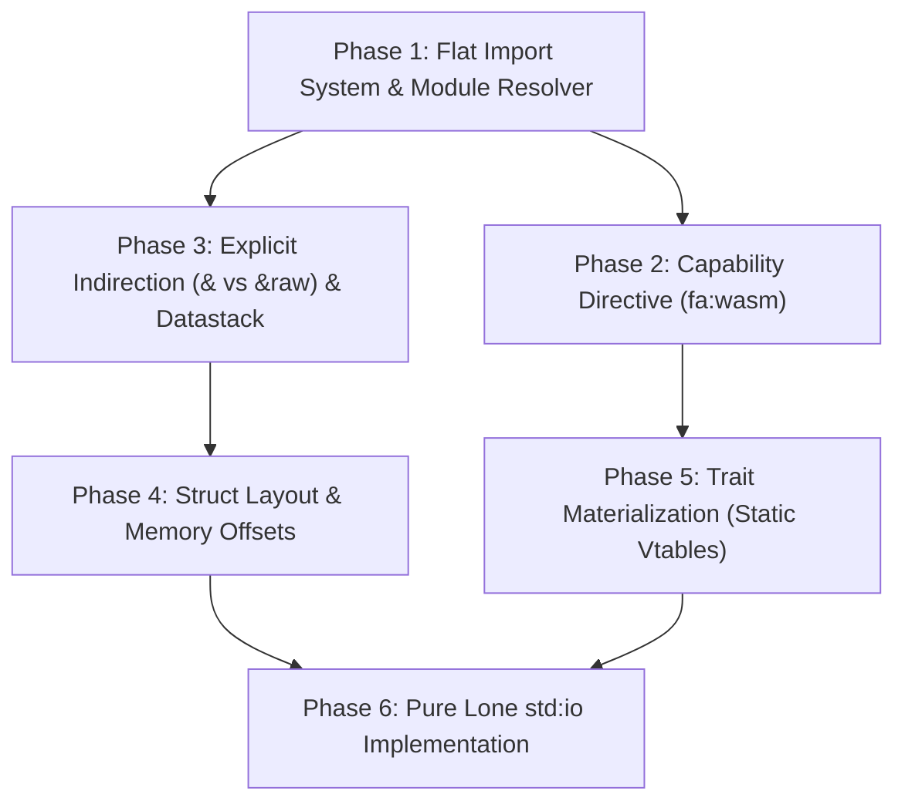

# Implementation Roadmap: Formal Imports, Memory Model & Pure `std:io`

- **Author:** Lone Core Team & AI Pair
- **Date:** 2026-11-02
- **Status:** Approved Plan & Technical Roadmap
- **Target Milestones:** Architecture v2 Toolchain (`cmd/lone`, `pkg/`, `lib/std/`)
- **Key RFCs:** [std_io_and_fa_wasm_directive.md](std_io_and_fa_wasm_directive.md), [SPEC.md](SPEC.md), [architecture_v2.md](architecture_v2.md)

---

## 1. Overview & Objectives

This roadmap lays out the sequential implementation path to transition Lone from hardcoded compiler intrinsics (`pkg/lone-runtime`) and external C stubs (`libraries/c-wasi-runtime`) to a **fully self-contained, pure Lone standard library (`std:io`)**.

### Primary Deliverables:
1. **Flat, Brace-Free Import System**: `import .foo, .bar from :somewhere` and `import .foo from .local`.
2. **Capability-Gated Directives**: `---fa:wasm` for safe host import declarations.
3. **Explicit Indirection (`&` vs `&raw`)**: Safe `ref<T>` vs raw `ptr<T>` (linear memory offsets).
4. **Linear Datastack (Shadow Stack)**: Bump allocation with $O(1)$ function frame rewinds in WebAssembly linear memory.
5. **Struct Layout & Offset Arithmetic**: Compiling structs to contiguous byte offsets with static method dispatch.
6. **Pure Lone `std:io`**: Low-level WASI Preview 1 driver (`sys.lone`) and high-level terminal I/O (`io.lone`).

---

## 2. Phase-by-Phase Execution Plan



---

### Phase 1: Flat Import System & Module Resolution

**Goal**: Enable files to import symbols using `import .symbol from <source>` without curly braces.

#### 1.1 AST Node Definitions (`pkg/lone-parser-ast/`)
- [ ] Define `ImportDecl`:
  ```go
  type ImportDecl struct {
      Pos      Position
      Symbols  []string  // List of imported symbol names (stripped of leading dot)
      Source   string    // e.g. ":std:io", ".utils", "..config"
      IsNamespace bool   // True if Source starts with ':'
      Alias    string    // Optional alias for 'import :ns as alias'
  }
  ```
- [ ] Add `ImportDecl` to the top-level declaration union (`TopLevelDecl`).

#### 1.2 PEG Grammar Updates (`pkg/lone-parser/parser.peg`)
- [ ] Add `IMPORT_STMT` to `TOP_LEVEL` rule.
- [ ] Define PEG rules:
  ```peg
  IMPORT_STMT <- "import" _ decl:(IMPORT_SYMBOLS / IMPORT_ALIAS) _ "from" _ src:IMPORT_SOURCE { ... }
  IMPORT_SYMBOLS <- head:IMPORT_SYMBOL tail:(_ "," _ IMPORT_SYMBOL)* { ... }
  IMPORT_SYMBOL  <- "." id:IDENTIFIER { return id }
  IMPORT_SOURCE  <- NAMESPACE_SOURCE / RELATIVE_SOURCE
  NAMESPACE_SOURCE <- ":" id:IDENTIFIER rest:(":" IDENTIFIER)*
  RELATIVE_SOURCE  <- "."+ id:IDENTIFIER? ("/" IDENTIFIER)*
  ```
- [ ] Regenerate Pigeon parser (`go run github.com/mna/pigeon ...`).
- [ ] Add comprehensive unit tests in `pkg/lone-parser/parser_test.go`.

#### 1.3 Module Resolution & Symbol Scoping (`pkg/lone-analyzer/`)
- [ ] Implement `ModuleResolver`:
  - If source starts with `:std:*`: Map to compiler library directory (`lib/std/` or embedded target code).
  - If source starts with `.*`: Resolve relative to the importing file's directory.
- [ ] Implement multi-file dependency graph and cycle detection.
- [ ] Scope injection: Inject imported symbols into the file's top-level scope.

---

### Phase 2: Host Capability Directives (`---fa:wasm`)

**Goal**: Allow low-level system modules to declare Wasm host imports declaratively and securely.

#### 2.1 Directive Parsing & AST Representation
- [ ] Extend `parser.peg` to extract directive blocks:
  ```lone
  ---fa:wasm
  import .fd_write, .fd_read from :wasi:snapshot_preview1
  ---
  ```
- [ ] Store active file directives in `ast.File.Directives`.

#### 2.2 Capability Gating in Analyzer
- [ ] Enforce compiler safety boundary:
  - If a file imports `:wasi:*` or host modules, assert that `---fa:wasm` is declared on that file.
  - Reject user application code attempting to import `:wasi:*` directly (emitting diagnostic error: `E_UNAUTHORIZED_HOST_IMPORT`).

#### 2.3 WIR Lowering of Imports (`pkg/lone-compiler-wir/`)
- [ ] Map `:wasi:snapshot_preview1` symbols to canonical Wasm module imports:
  ```wat
  (import "wasi_snapshot_preview1" "fd_write" (func $fd_write (param i32 i32 i32 i32) (result i32)))
  ```

---

### Phase 3: Explicit Indirection (`&` vs `&raw`) & Datastack

**Goal**: Support both safe managed references (`ref<T>`) and raw linear memory offsets (`ptr<T>`), backed by an $O(1)$ datastack.

#### 3.1 Grammar & AST: Address-of Operators
- [ ] In `pkg/lone-parser/parser.peg`:
  - Support `&raw` as prefix unary operator `UNARY_OP_RAW_REF`.
  - Keep `&` as prefix unary operator `UNARY_OP_REF`.
- [ ] In `pkg/lone-analyzer/eval_type.go`:
  - `&x` $\rightarrow$ returns `TypeRef{ Inner: typeof(x) }`.
  - `&raw x` $\rightarrow$ returns `TypePtr{ Inner: typeof(x) }`, and marks `x` as `AddressTaken = true`.

#### 3.2 Datastack (Shadow Stack) in MIR & WIR
- [ ] Reserve linear memory layout:
  - `0 .. 1024`: Scratchpad & null guard page.
  - `1024 .. N`: Linear datastack growing upwards/downwards.
- [ ] Define global variable in WIR: `(global $__stack_pointer (mut i32) (i32.const 65536))`.
- [ ] Function Frame Lowering in `pkg/lone-compiler-mir/`:
  - Calculate frame size: sum of sizes of all `AddressTaken` local variables.
  - **Prologue**: Bump `$__stack_pointer`:
    ```wat
    (global.set $__stack_pointer (i32.sub (global.get $__stack_pointer) (i32.const FrameSize)))
    ```
  - **Epilogue**: Rewind `$__stack_pointer` before every `return`:
    ```wat
    (global.set $__stack_pointer (i32.add (global.get $__stack_pointer) (i32.const FrameSize)))
    ```
- [ ] Lower `&raw x`:
  - Evaluate to `(i32.add (global.get $__stack_pointer) (i32.const x_offset))`.

---

### Phase 4: Struct Memory Layout & Pointer Arithmetic

**Goal**: Lower structs to linear memory bytes and translate field accesses into constant-offset loads and stores.

#### 4.1 Struct Layout Engine (`pkg/lone-analyzer/` & `pkg/lone-compiler-mir/`)
- [ ] Compute struct layout:
  - Field byte offsets, natural alignment (1, 2, 4, 8 bytes), total padded size.
- [ ] Struct instantiation (`Rect{ w: 10, h: 20 }`):
  - When instantiated locally: Allocate frame slot on datastack and emit sequential `i32.store` instructions.

#### 4.2 Member Access Lowering
- [ ] Field read (`r.h`):
  - Base address + field offset $\rightarrow$ `(i32.load offset=4 (base_ptr))`.
- [ ] Field write (`r.h = 42`):
  - Base address + field offset $\rightarrow$ `(i32.store offset=4 (base_ptr) (val))`.

#### 4.3 Associated Functions / Instance Methods
- [ ] Methods with `self` parameter:
  - Lower `r.scale(2)` into static call:
    ```wat
    (call $Rect__scale (local.get $r_ptr) (i32.const 2))
    ```
  - Pass struct pointer as first argument (`$self`).

---

### Phase 5: Trait Materialization & Static Method Dispatch

**Goal**: Treat materialized traits (`Comparable::|Rect|`) as zero-sized function bundles.

#### 5.1 Trait AST & Semantic Analysis
- [ ] Support `impl TraitName<T> on T` blocks.
- [ ] Validate that all required trait methods are implemented with matching signatures.

#### 5.2 Materialization Evaluation
- [ ] Evaluate `let cmp = Trait::|T|` at compile time:
  - Evaluates to a 0-sized unit type.
  - Calls `cmp.compare(a, b)` resolve statically to `call $Trait_T__compare(a, b)`.
  - Zero dynamic memory allocation and zero runtime overhead.

---

### Phase 6: The Pure-Lone Standard Library (`std:io`)

**Goal**: Author `lib/std/sys.lone` and `lib/std/io.lone` entirely in Lone, and deprecate the C runtime.

#### 6.1 WASI Syscall Bridge (`lib/std/sys.lone`)
- [ ] Author Preview 1 structures and functions:
  ```lone
  ---fa:wasm
  import .fd_write, .fd_read from :wasi:snapshot_preview1
  ---

  pub type Ciovec = struct {
      buf: ptr<uint8>,
      len: uint32,
  }

  pub fn sys_write(fd: int, data: []uint8) int {
      let iov = Ciovec{ buf: &raw data[0], len: data.len }
      let nwritten = 0
      fd_write(fd, &raw iov, 1, &raw nwritten)
      return nwritten
  }

  pub fn sys_read(fd: int, buf: &mut []uint8) int {
      let iov = Ciovec{ buf: &raw buf[0], len: buf.len }
      let nread = 0
      fd_read(fd, &raw iov, 1, &raw nread)
      return nread
  }
  ```

#### 6.2 High-Level Standard I/O (`lib/std/io.lone`)
- [ ] Implement user-facing functions:
  - `print(msg: string) void`
  - `println(msg: string) void`
  - `read_line() string`
  - `type Reader` and `type Writer` interfaces.

#### 6.3 End-to-End Validation
- [ ] Write integration test: `test/behavior/io_pure_lone.lone`:
  ```lone
  import .println, .read_line from :std:io

  fn main() void {
      println("Hello from Pure Lone std:io!")
  }
  ```
- [ ] Run with `lone build` and execute on `wasmtime` and Node.js (`node:wasi`).
- [ ] Retire `libraries/c-wasi-runtime` as legacy/optional.

---

## 3. Progress Tracking & Milestone Schedule

| Milestone | Key Deliverable | Target Timeline | Verification Test |
| :--- | :--- | :---: | :--- |
| **M1** | Flat Import PEG Grammar & AST | Step 1 | `pkg/lone-parser/parser_test.go` |
| **M2** | Multi-file Module Resolution | Step 2 | `lone check test/behavior/import_test.lone` |
| **M3** | Datastack & `&raw` Lowering | Step 3 | Linear memory offset assertions in WIR |
| **M4** | Struct Layout & Pointer Loads/Stores | Step 4 | Field mutation tests in Wasm |
| **M5** | `lib/std/sys.lone` & `lib/std/io.lone` | Step 5 | Standalone execution with `wasmtime` |
